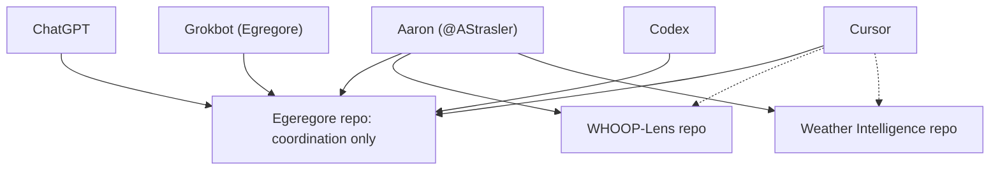
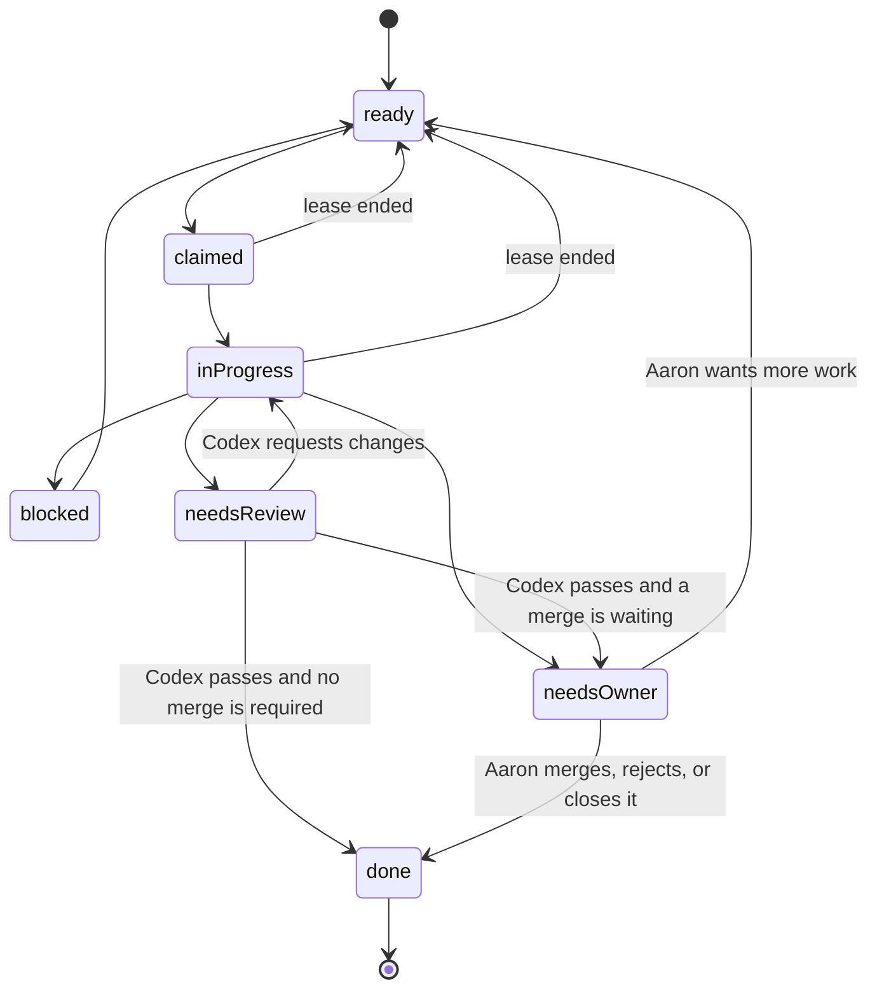

# Architecture

Egregore is a coordination layer on top of GitHub. It lives in this repository. Project code, project data, and credentials live in each hobby project's own repository.

A dotted line exists only after Aaron has granted that agent access to that repository. An issue in this repo does not create the grant. Cross-project coordination does not include cross-project data access.

## What runs here

- Issue forms for a task, a handoff, an evidence report, a review request, and an owner decision.
- Labels for status, agent, project, priority, and issue type. `scripts/create-labels.sh` creates them. Aaron runs that script. This pull request does not create the labels on GitHub.
- A claim comment with `Lease-Expires`. The lease is how an agent holds a task and how another agent recovers it after an interruption.
- Three workflows on GitHub-hosted `ubuntu-latest` runners, each with a 5-minute timeout:
  - `CI` runs the unit tests.
  - `Issue hygiene` checks issue fields and records an owner decision line.
  - `Lease watch` runs once a day and relabels claims whose lease has ended.

Workflows use `GITHUB_TOKEN` with the `permissions:` block in each file. They use no Actions secrets and no deploy steps. The only third-party action is the pinned official `actions/checkout` action.

## Where a unit of work lives

1. ChatGPT or Grokbot opens a **task** in this repo.
2. The agent who will do it **claims** the task.
3. Coding happens in the project repository Aaron already opened to that agent. Cursor opens a pull request there.
4. Cursor links the pull request from the task. Codex's GitHub app reviews the pull request. An issue mention does not start that review.
5. On a pass, open an owner-decision issue linking the task and the pull request, and set the task to `status:needs-owner`. Aaron merges. The agent who opened the pull request does not merge it.
6. Grokbot records **evidence** and moves the task to `status:done`.

A small update can be a progress comment on the task. Open a separate evidence issue for a milestone or for completion.

## Issue states

One status label at a time.

`lease:expired` can sit next to `status:ready` until the next claim removes it. It marks a lapsed claim. The status label is still the state of the task.

## Identity

The only GitHub login this system treats as the owner is `@AStrasler`. The other agents identify themselves with `Claim-Agent: chatgpt`, `grokbot`, `cursor`, `codex`, or `aaron`. Those words are role names. Today those four roles post as `@AStrasler` unless the MCP server is started with the GitHub App. That app, once Aaron creates it and installs it only on this repository, posts as its bot (for example `egregore[bot]`). This repo does not invent GitHub accounts for the roles, and it does not create the app. See [mcp/README.md](mcp/README.md).

`github-actions[bot]` posts hygiene, lease, and decision notes. `chatgpt-codex-connector[bot]` posts pull-request reviews. Neither bot claims work.

## Enforcement

[SECURITY.md](SECURITY.md) lists which controls GitHub enforces and which ones stay a working rule. The short version:

- Workflow token scopes are enforced by the `permissions:` key.
- Issue-form fields are enforced in the web UI. Blank issues are disabled.
- A comment that starts with `Decision:` is recorded when GitHub says the author is `@AStrasler`. The workflow does not treat that login as verified authorization and does not change labels from it.
- The `Protect main` ruleset requires a pull request and the `test` check, and it blocks force pushes and branch deletion. Required approving reviews and code-owner review are off. See [OPERATIONS.md](OPERATIONS.md).
- The data boundary is a rule plus a checkbox and a credential-pattern comment. GitHub will still store text that a person with write access pastes.
